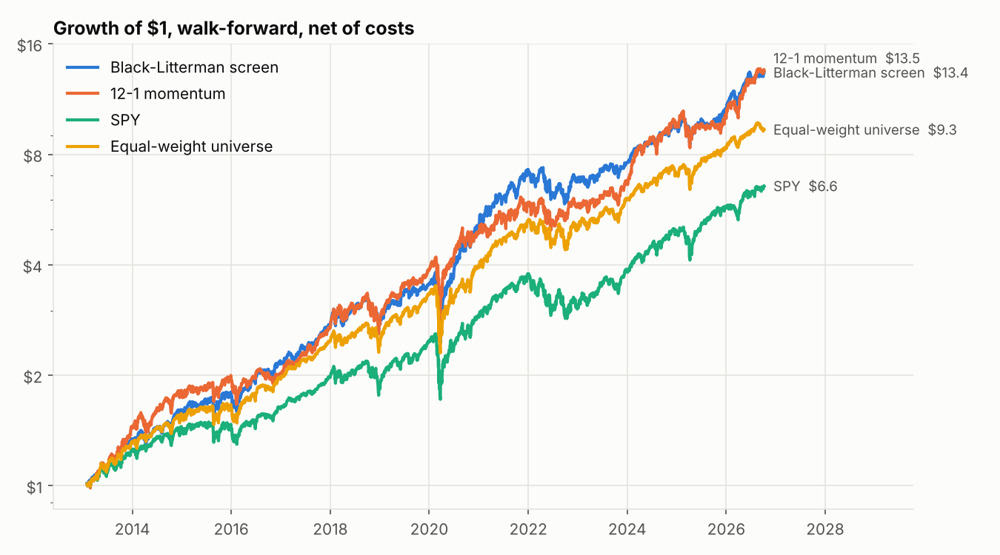
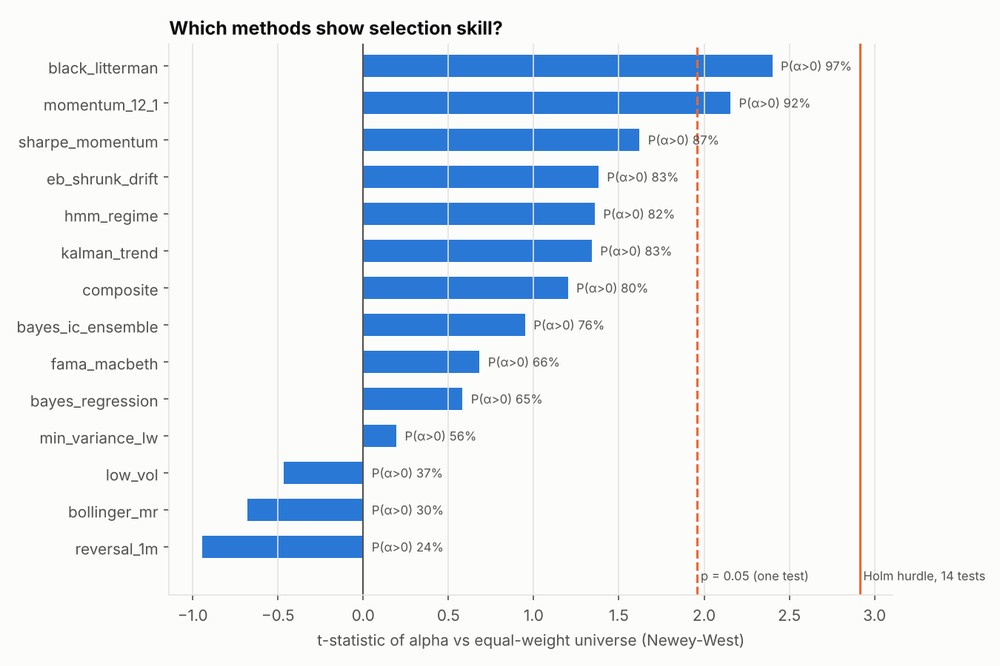
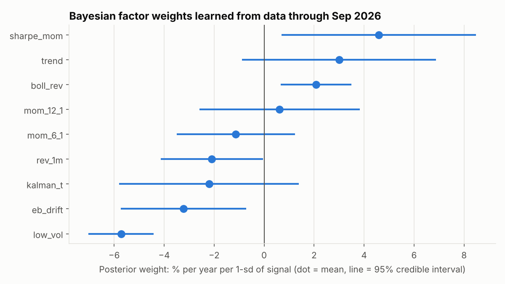
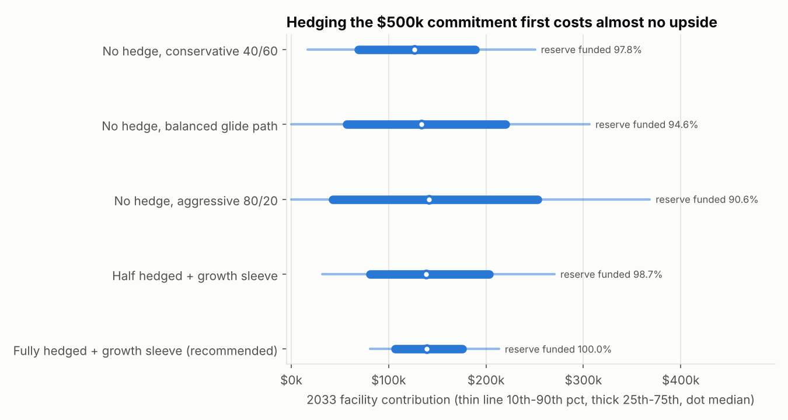
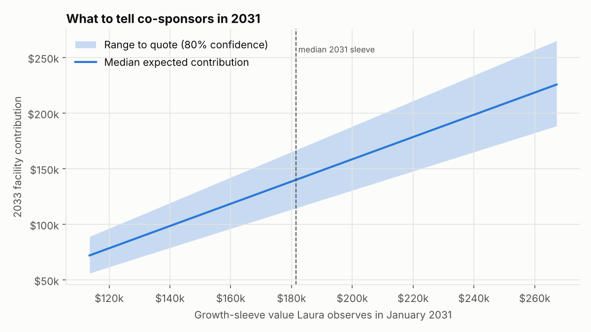

# Statistical stock screener and investment plan for Laura Gao

*Data through October 07, 2026. Generated by `python -m screener report`.*

## 1. Bottom line

1. **Lock in the operating commitment first.** With 10-year Treasury yields near 5.3%, about $295,000 of the 2027 deposit buys a Treasury zero-coupon ladder that pays every $50k installment from 2033 to 2042. Across 50,000 simulated paths this funds the commitment in **100%** of cases, against 91%-98% for conventional unhedged portfolios. The median facility contribution is no lower.
2. **Run the stock strategy in the growth sleeve** (the rest of 2027 plus the 2028 deposit). Of 14 statistical methods tested walk-forward, the **Bayesian Black-Litterman screen with factor views** was the strongest and most robust. Its edge over SPY is statistically significant after correcting for multiple tests. Its edge over an equal-weight version of the same universe is likely but not proven.
3. **Tell co-sponsors a range, not a number.** In 2031, quote the 10th-90th percentile range from the rule in Section 5. In out-of-sample checks the realized contribution landed inside the quoted range 80% of the time and below it only 11% of the time. The operating reserve is never at risk because it is already locked in.

## 2. Stock-selection methods compared

All methods were run on the same 131-stock large-cap universe from Feb 2013 to Oct 2026. Rules: monthly rebalance, 10 bp costs, only data available at each date, top 15 names, at most 3 per sector, a 10% cap per name. Bayesian and regression methods train only on months whose outcomes were already known.

| Method | CAGR | Sharpe | Max DD | Beta | α vs SPY (t) | Holm p | α vs EW (t) | P(α_EW>0) | IC t | Deflated SR (vs EW) |
|---|---:|---:|---:|---:|---:|---:|---:|---:|---:|---:|
| Black-Litterman with factor views | 20.9% | 1.04 | -36% | 0.88 | 6.8% (3.73) | 0.003 | 4.0% (2.40) | 97% | 0.17 | 0.24 |
| 12-1 month momentum | 21.0% | 0.98 | -32% | 0.85 | 7.4% (3.14) | 0.022 | 5.0% (2.15) | 92% | 0.90 | 0.18 |
| Risk-adjusted momentum (return / vol) | 18.4% | 0.94 | -33% | 0.78 | 6.0% (2.62) | 0.104 | 3.5% (1.62) | 87% | 0.62 | 0.03 |
| Empirical-Bayes (James-Stein) shrunk drift | 16.9% | 0.89 | -33% | 0.72 | 5.4% (2.47) | 0.147 | 2.8% (1.38) | 83% | 1.13 | 0.01 |
| Composite + HMM regime switch to T-bills | 14.3% | 0.89 | -18% | 0.57 | 4.8% (2.27) | 0.179 | 2.9% (1.36) | 82% | 0.07 | 0.00 |
| Kalman-filter trend t-statistic | 16.1% | 0.90 | -26% | 0.67 | 5.3% (2.47) | 0.147 | 2.7% (1.34) | 83% | -0.07 | 0.00 |
| Equal-weight 4-factor composite (momentum, low vol, trend) | 17.1% | 0.88 | -35% | 0.76 | 5.1% (2.45) | 0.147 | 2.4% (1.20) | 80% | 0.07 | 0.01 |
| Bayesian IC-weighted signal ensemble | 17.9% | 0.90 | -33% | 0.86 | 4.6% (2.28) | 0.179 | 1.7% (0.95) | 76% | 0.52 | 0.02 |
| Rolling Fama-MacBeth factor premia | 20.6% | 0.93 | -39% | 1.07 | 4.6% (1.89) | 0.311 | 1.8% (0.68) | 66% | 1.16 | 0.17 |
| Bayesian regression: posterior factor weights | 20.4% | 0.90 | -39% | 1.08 | 4.4% (1.94) | 0.311 | 1.4% (0.58) | 65% | 0.84 | 0.18 |
| Minimum variance (Ledoit-Wolf covariance) | 12.7% | 0.87 | -29% | 0.60 | 3.1% (1.61) | 0.429 | 0.3% (0.19) | 56% | - | 0.00 |
| Low volatility | 11.3% | 0.74 | -29% | 0.57 | 2.3% (1.00) | 0.603 | -0.9% (-0.47) | 37% | -1.92 | 0.00 |
| Bollinger-band mean reversion (20-day z) | 15.8% | 0.85 | -32% | 0.86 | 2.8% (1.31) | 0.572 | -1.1% (-0.68) | 30% | 1.41 | 0.00 |
| 1-month reversal | 16.6% | 0.79 | -38% | 0.97 | 2.3% (1.03) | 0.603 | -1.7% (-0.95) | 24% | 0.75 | 0.01 |

Benchmarks: SPY 14.8%/yr (Sharpe 0.80); equal-weight universe 17.8%/yr.

### How to read the statistics

- **α vs SPY / vs EW**: annualized intercept from regressing monthly excess returns on the benchmark, with Newey-West standard errors (robust to autocorrelation and changing volatility). The equal-weight (EW) benchmark holds every stock in the same universe. It is the fairer test, because today's large caps are survivors (survivorship bias) and equal weighting tilts toward smaller names. Both biases inflate any portfolio drawn from this list.
- **Holm p**: p-value adjusted for testing all methods at once (family-wise error control). Benjamini-Hochberg (FDR) values are in `method_comparison.csv`.
- **P(α>0)**: Bayesian posterior probability of positive alpha under a skeptical N(0, 2%²) prior, the belief that most strategies have little or no alpha. The Bayes factor (BF10, in the CSV) compares "some alpha" with "no alpha" (Savage-Dickey). Above 3 is substantial evidence, above 10 strong.
- **IC t**: t-statistic of the monthly Spearman rank correlation between a method's score and next-month returns. It tests whether the ranking itself predicts.
- **Deflated SR**: probability that the active Sharpe ratio beats the best you would expect from 14 tries with no skill (Bailey & López de Prado).

### What the evidence says

- **Black-Litterman** has alpha vs SPY of 6.8%/yr (t = 3.73, Holm-adjusted p = 0.003, BF10 = 30). Against equal weight: 4.0%/yr (t = 2.40), posterior P(α>0) = 97%. Positive in each sub-period (2013-17, 2018-21, 2022-26). Insensitive to τ and the IC scale, and alpha turns negative with the views removed, so the factor views are doing the work.
- **Plain 12-1 momentum** is the runner-up (t vs EW = 2.15). Most of its edge came after 2022.
- **Low volatility, minimum variance and the HMM regime switch** did not add return. They did cut risk: beta 0.57-0.60 and HMM max drawdown -18% vs SPY's. They belong in the risk toolkit, not the alpha engine.
- **Short-term reversal and Bollinger mean reversion** show no reliable selection skill in large caps.
- **Honest limit:** no method clears the deflated-Sharpe or Holm hurdle against the equal-weight benchmark. We therefore assume **zero alpha** in Laura's long-term projections (Section 4) and treat any outperformance as upside.

### What the Bayesian regression learned

The Bayesian regression starts from a skeptical prior (each signal worth 0 ± 0.4%/month) and updates every month as returns arrive. The posterior shows which signals the data actually supports:

Read these weights jointly, not one at a time. Several signals are highly correlated (12-1 momentum, risk-adjusted momentum, Kalman trend and the empirical-Bayes drift have pairwise correlations of 0.7-0.95). The regression can therefore trade one off against another, e.g. a large positive weight on risk-adjusted momentum (return ÷ volatility) offset by a negative weight on low volatility. The combined message: the data rewards recent winners with strong trends and does not reward low volatility for its own sake. That agrees with the single-signal results above.

## 3. Laura's plan: strategies compared

50,000 Monte Carlo paths per strategy, with fat-tailed (Student-t) returns. Expected returns are themselves uncertain: each path draws its own long-run means from a prior around our assumptions (Bayesian parameter uncertainty). Assumptions (nominal, annual):

| Asset | Expected return | Volatility | Prior sd of the mean |
|---|---:|---:|---:|
| US equity | 6.5% | 16.0% | 2.0% |
| Intl equity | 7.0% | 17.0% | 2.0% |
| Core bonds | 4.8% | 6.0% | 1.0% |
| T-bills | 3.5% | 1.0% | 0.5% |

Treasury zero yield at the 2027 purchase: 5.25% ± 0.75% (10-yr Treasury was 5.3% in Oct 2026). Yield in 2033: 4.5% ± 1.25%. Inflation 2.5%/yr, facility-cost inflation 3.0%/yr. No alpha is assumed from stock selection. Flexibility buffer: keep the larger of $50k and 10% of the 2033 portfolio uncommitted.

| Strategy | P(reserve funded) | Median 2033 portfolio | Contribution 10th pct | Median | 90th pct | P(no contribution) |
|---|---:|---:|---:|---:|---:|---:|
| No hedge, conservative 40/60 | 97.8% | $600,863 | $17,078 | $126,747 | $250,373 | 7.1% |
| No hedge, balanced glide path | 94.6% | $608,832 | $0 | $133,932 | $306,385 | 12.0% |
| No hedge, aggressive 80/20 | 90.6% | $616,844 | $0 | $141,399 | $368,258 | 16.5% |
| Half hedged + growth sleeve | 98.7% | $614,082 | $31,530 | $138,322 | $270,337 | 4.9% |
| Fully hedged + growth sleeve (recommended) | 100.0% | $615,643 | $81,038 | $139,090 | $213,342 | 0.1% |

**Why the hedge wins.** The ten payments are fixed in dollars, so a portfolio that owns exactly those cash flows (zero-coupon Treasuries maturing each January 2033-2042) carries no market risk relative to the goal. At today's yields that ladder is cheap, about $295,337, and it leaves ~$154,663 plus all its future growth for the facility. The unhedged portfolios must instead outrun the cost of the reserve, which is why 2%-9% of their paths fall short.

## 4. Operating reserve recommendation

**Definition of high certainty:** at least a 99% probability, under fat-tailed simulation with parameter uncertainty, that all ten payments are made from the portfolio alone, and the plan still holds under every historical-style stress test below.

Reserve size needed in 2033 for each design (at a 4.5% average yield):

| Reserve design | 90% certainty | 95% certainty | 99% certainty |
|---|---:|---:|---:|
| Treasury ladder, all 10 payments | $441,406 | $450,195 | $466,797 |
| Ladder for years 1-5, 60/40 for 6-10 | $466,797 | $493,164 | $561,523 |
| All in 30/70 | $459,961 | $479,492 | $526,367 |
| All in 60/40 | $489,258 | $525,391 | $618,164 |

**Recommendation:** a Treasury zero-coupon ladder, one rung maturing each January 2033-2042. Its 2033 market value is about $413,626, between $382,149 and $449,874 depending on 2033 rates. Bought in 2027, it costs ~$295,337. **How it changes over time:** it needs no rebalancing. Each January one rung matures and pays that year's $50k, so the reserve shrinks by exactly one payment a year and its remaining duration falls automatically. Holding to maturity removes interest-rate risk. The only remaining risk is a U.S. Treasury default.

Stress tests (recommended strategy, 20,000 paths each):

| Scenario | Median 2033 portfolio | P(reserve funded) | Median contribution | 10th pct contribution |
|---|---:|---:|---:|---:|
| Base case | $615,145 | 100.0% | $139,300 | $81,234 |
| 2008-style crash in 2032 | $576,836 | 100.0% | $104,892 | $59,263 |
| 2022-style stock-and-bond selloff in 2032 | $580,255 | 100.0% | $107,980 | $61,428 |
| Lost half-decade (flat equities 2027-2031) | $580,808 | 100.0% | $109,224 | $78,066 |
| Rates fall to 3.5% before the 2027 purchase | $542,204 | 100.0% | $73,422 | $38,368 |
| Rates fall to 2% by 2033 | $658,830 | 100.0% | $134,929 | $76,993 |

The main risk to the plan is **rates falling before the January 2027 purchase**. The ladder then costs more and the facility contribution shrinks. Mitigation: buy the ladder in the first days of January 2027, and do not wait for the 2028 deposit.

## 5. Facility contribution and co-sponsor communication

From today's vantage point the 2033 facility contribution has a median of **$139,090**. There is an 80% chance it falls between $81,038 and $213,342, and a 0.1% chance it is zero. In 2026 dollars, adjusting for 3% facility-cost inflation, the median is $113,093.

**Rule for 2031.** Look up the growth-sleeve value in January 2031 and quote the shaded range:

| Sleeve value Jan 2031 | Quote: low end | Median | High end |
|---:|---:|---:|---:|
| $128,035 | $68,662 | $86,608 | $105,585 |
| $152,428 | $89,704 | $110,997 | $133,577 |
| $181,463 | $114,685 | $140,057 | $166,849 |
| $213,429 | $142,220 | $172,016 | $203,495 |
| $245,734 | $170,000 | $204,313 | $240,549 |

Out-of-sample check (ranges built on half the paths, tested on the other half): the realized contribution was inside the quoted range **80%** of the time, below it 11% and above it 10%. We are therefore **80% confident** the contribution will fall in the quoted range. Because the reserve is already locked in, a shortfall reduces only the facility contribution, never the operating payments. The sleeve shifts toward bonds in 2031-32 so the range stays tight once it has been quoted.

**Draft fundraising language (median scenario):**

> Laura Gao has fully pre-funded the residency's first ten years of operating support, $50,000 a year from 2033 through 2042, with U.S. Treasury securities set aside for that purpose alone. In addition, she expects to contribute **$110,000 to $170,000** toward establishing the facility in 2033. This range is based on her current investment portfolio and conservative market assumptions. Her portfolio managers estimate an 80% likelihood that her contribution falls within it. She will confirm the final amount in early 2033.

## 6. Current portfolio: Black-Litterman screen

| Ticker | Verdict | Weight | BL posterior return | P(drift>0) | Beta | 1-day 95% VaR |
|---|---|---:|---:|---:|---:|---:|
| MPC | BUY | 10.0% | 1.7% | 97% | -0.13 | 3.60% |
| PSX | BUY | 10.0% | 1.7% | 98% | -0.23 | 2.85% |
| MSFT | BUY - half size | 4.2% | 1.2% | 85% | 0.96 | 2.80% |
| KO | BUY | 8.0% | 1.0% | 96% | -0.24 | 1.56% |
| AMD | BUY - half size | 3.5% | 5.8% | 92% | 3.17 | 5.72% |
| JNJ | BUY | 6.0% | 1.3% | 97% | -0.18 | 1.78% |
| MU | BUY - half size | 2.9% | 6.0% | 93% | 3.27 | 7.00% |
| V | BUY | 5.8% | 2.0% | 86% | 0.30 | 1.80% |
| NUE | BUY | 5.8% | 4.0% | 96% | 0.95 | 3.02% |
| SPG | BUY | 5.7% | 2.1% | 91% | 0.26 | 1.74% |
| TMO | BUY | 5.7% | 2.5% | 90% | 0.54 | 2.57% |
| VZ | BUY - half size | 2.8% | 0.8% | 90% | -0.29 | 2.22% |
| CRM | BUY - half size | 2.7% | 0.5% | 84% | 0.44 | 4.10% |
| PM | BUY | 5.3% | 1.4% | 92% | -0.16 | 2.94% |
| MRK | BUY | 5.3% | 2.9% | 96% | 0.17 | 2.40% |

Full per-trade justifications are in [TRADING_NOTES.md](TRADING_NOTES.md).

## 7. Limitations

- Universe = today's large caps, so the backtest has survivorship bias. That is why the equal-weight universe is the key benchmark.
- Price-based factors only. Free fundamental data is not point-in-time, and using it would leak future information.
- Backtests overstate what is achievable live. We assume zero alpha in Laura's projections.
- Capital-market assumptions are judgments. Change them in `screener/laura_plan.py` and rerun.
- Not investment advice. Built for the Wharton Global Youth investment competition.
